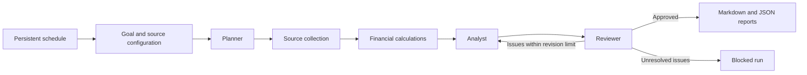

# Autonomous Research Pipeline

A runnable research-and-reporting pipeline for finance, with a general research mode. Give it a goal and a collection of sources; it plans the research, collects evidence, calculates financial metrics, produces an analysis, critiques it, revises when needed, and writes a cited report. Jobs can run on a persistent interval schedule.

This is a local MVP for research and report production. The AI roles use separate model calls with explicit JSON contracts. The offline demo uses deterministic excerpts so the entire workflow can be exercised without an account or API key. Neither mode executes trades or sends reports to other people.

## Start in one command

Requires Python 3.11+ on macOS or Linux. There are no third-party runtime dependencies.

```sh
python3 -m aiagents run examples/finance-demo.json
```

The command prints a run ID and paths to `report.md` and `report.json` under `.aiagents/reports/<run-id>/`. The supplied companies, figures, and business evidence are fictional and labeled as such. The demo makes no model calls; the supplied demo jobs also use only local files.

```sh
python3 -m aiagents run examples/general-demo.json
python3 -m aiagents runs
python3 -m aiagents status RUN_ID --events
python3 -m aiagents resume RUN_ID
```

Replace `RUN_ID` with an ID printed by a run. Put `--state-dir /path/to/state` **before** the command to use a different database and report directory. Installation is optional: `python3 -m pip install -e .` adds the `aiagents` command.

## Use an AI model

Set these environment variables in the terminal that runs the pipeline. Choose a model available to your account that supports Responses API structured outputs. The project deliberately has no hardcoded model default.

```sh
export OPENAI_API_KEY='your-api-key'
export OPENAI_MODEL='your-supported-model-id'
python3 -m aiagents run examples/finance-live.json
```

`finance-live.json` means a **live model with synthetic local evidence**, not live market data. Replace its sources and goal to research a real business. Source text is sent to the configured model service. API credentials are read from the environment and are never written into jobs, checkpoints, or reports. `.env` files are ignored by Git but are not automatically loaded.

The adapter uses the [OpenAI Responses API structured output format](https://developers.openai.com/api/docs/guides/structured-outputs?api-mode=responses), `store: false`, one HTTP request per attempt, and a 4,000 output-token cap per request. Each request can incur API charges. Request limits and output caps are not a dollar-denominated spending limit.

## How it runs



- **Planner:** chooses research questions and focus areas within the configured source collection.
- **Collector:** reads local documents or explicitly allowed HTTPS URLs, with timestamps and content hashes.
- **Calculator:** computes financial metrics in Python using decimal arithmetic and declared units.
- **Analyst:** produces structured findings with source IDs, confidence labels, risks, and limitations.
- **Reviewer:** receives the evidence and analysis in a separate model call and can request revisions.
- **Reporter:** publishes local Markdown and JSON only after citation validation and review pass.

Each stage saves a SQLite checkpoint. File locks prevent simultaneous execution of the same run or schedule, including manual resume of an older failed run. Failed attempts consume the request budget before the request begins, including attempts interrupted by a crash. An interrupted request may be repeated on resume; model calls are not exactly-once operations. Completed checkpoints are reused. A persisted final result can regenerate missing reports without calling a model.

## Define a job

Create a JSON job next to its source directory:

```json
{
  "goal": "Summarize the company's reported performance, cash generation, risks, and missing evidence.",
  "domain": "finance",
  "provider": "openai",
  "sources": [
    {"id": "results", "title": "Company results", "path": "data/results.json"},
    {"id": "update", "title": "Business update", "path": "data/update.md"}
  ],
  "allowed_hosts": [],
  "min_sources": 2,
  "max_model_calls": 12,
  "max_retries": 2,
  "max_revisions": 1
}
```

| Field | Meaning |
|---|---|
| `domain` | `finance` adds financial guidance and calculations; `general` uses the same pipeline without financial metrics. |
| `provider` | `demo` produces deterministic excerpts; `openai` calls a real model. |
| `model` | Optional model ID; otherwise `OPENAI_MODEL` is resolved and saved when submitting the job. |
| `sources` | 1–10 documents, each with a unique `id` and exactly one `path` or `url`. |
| `min_sources` | Minimum successfully collected documents; default 1. |
| `max_model_calls` | Total reasoning attempts per run, including retries; default 12. Also counts demo role invocations. |
| `max_retries` | Additional attempts per stage, preserved across resume; default 2. |
| `max_revisions` | Number of analyst revisions after the initial analysis; default 1. |

Local `.txt`, `.md`, and `.json` sources must be inside the job's directory. Paths are relative to the job file, regardless of the current working directory. Escaping that directory, including through symlinks, is rejected. Source contents are snapshotted on collection; resume reuses the snapshot. A fresh run collects sources again.

For an online source, replace `path` with `url` and add its exact lowercase hostname to `allowed_hosts`. Use the final HTTPS URL: redirects, credentials in URLs, private network addresses, and ports other than 443 are rejected. Network retrieval supports UTF-8/ASCII text, HTML, and JSON; it does not render JavaScript or read PDF filings. Add a source adapter to support a data vendor or another format.

Each document is limited to 1 MiB and 100,000 extracted characters. The model sees at most the first 12,000 characters per source; truncation is recorded in the report. Split long documents into focused inputs for better coverage. Source retrieval failures appear in status and, when enough other evidence remains, in report limitations.

## Financial data format

Structured financial JSON uses a declared currency and scale and lists periods **oldest to newest**:

```json
{
  "company": "Fictional Example",
  "synthetic": true,
  "currency": "USD",
  "scale": "millions",
  "periods": [
    {"period": "FY2024", "revenue": 100, "net_income": 12, "cash": 30, "debt": 20, "operating_cash_flow": 18, "capex": 8},
    {"period": "FY2025", "revenue": 125, "net_income": 17.5, "cash": 38, "debt": 18, "operating_cash_flow": 24, "capex": 10}
  ]
}
```

Supported scales are `units`, `thousands`, `millions`, and `billions`. Capex means positive cash outflows. Calculated metrics include net profit margin, free cash flow, net debt, debt-to-cash ratio, and revenue change versus the previous listed period. Source IDs and formulas accompany each value. Missing inputs or zero denominators produce unavailable metrics. The pipeline does not infer period order or normalize incomparable periods and accounting definitions.

## Schedule unattended runs

```sh
python3 -m aiagents schedule add daily-finance examples/finance-live.json --every 86400
python3 -m aiagents schedule list
python3 -m aiagents worker
```

The worker stays in the foreground; Ctrl-C stops it. For continuous operation, run it under your process supervisor on an always-on machine. Registration alone does not start a worker. A new schedule is due immediately, and subsequent runs use an interval in seconds, not a calendar timezone or market-hours schedule. Scheduling a live job requires the same model environment configuration as a manual run.

```sh
python3 -m aiagents worker --once
python3 -m aiagents schedule disable daily-finance
```

Schedule registration saves the job configuration. Editing its JSON file does not alter an existing schedule; disable it and register a new name to apply changes. Source files are read afresh for each new run. Missed intervals are coalesced rather than replayed. Scheduling creates a run and advances its next due time in one database transaction. Unfinished runs prevent overlapping runs for that schedule. Disabling a schedule prevents future enqueueing; already queued runs remain available.

`blocked` means evidence, review, or an attempt budget prevented publication. Inspect the run, correct the job, and start a new run. Resume never resets a budget or bypasses a blocked review. `failed` runs can be resumed after fixing the cause (for example, a missing API key or an output filesystem error), subject to the original stage and total attempt limits. The worker does not repeatedly retry failed or blocked runs.

## Validation and scope

```sh
python3 -m unittest discover -s tests -v
```

Tests exercise the workflow, persistence, scheduler, provider HTTP contract, source boundaries, financial arithmetic, and CLI. Live provider calls require your credentials and are not part of the automated suite.

The current research loop operates over configured sources. It does not discover arbitrary web sources, connect to a brokerage, authenticate to data vendors, send email, or deploy cloud infrastructure. Source IDs and a second model review help catch mistakes, but do not prove a claim is supported or correct. The JSON report includes the evidence excerpts, source hashes, calculations, and limitations for inspection.

To extend it: add a provider in `aiagents/providers.py`, a source adapter in `aiagents/sources.py`, or domain guidance and deterministic tools in `aiagents/domains.py`. Keep tools bounded and explicit. The existing run/checkpoint/report contracts can then be reused across domains.
